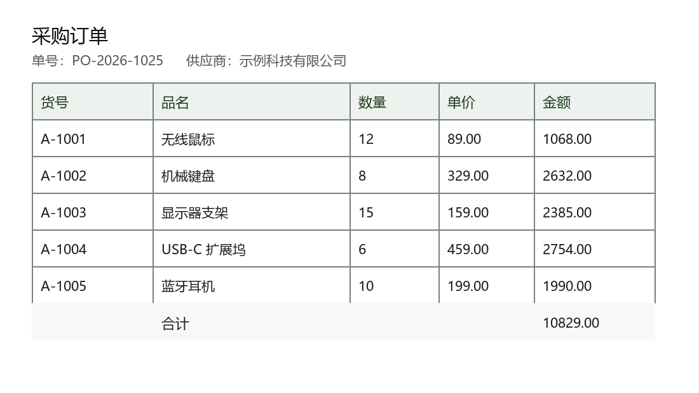

# SimOCR

**简体中文** ｜ [English](README.en.md)

## 截图里的文字和表格，一键变成 Word / Excel

> **上面的绿色按钮就是最新版下载页。** 点进去以后，在页面下方的 **Assets / 资源** 里找到
> **`SimOCR-…-setup-win-x64.exe`**（文件名里的版本号会随版本变化，认准以
> `-setup-win-x64.exe` 结尾的那个），再点一次就能下载。下载 → 双击 → 装完就能用。

---

## 这个软件能做什么

按下快捷键 `F1`，屏幕会被「冻住」，你用鼠标框住任意一块画面，就能：

| 你能得到的 | 说明 |
| --- | --- |
| **电脑里的图片** | 框完点「保存」，PNG 图片直接存到你的「下载」文件夹 |
| **可以直接粘贴的图** | 框完点「复制」，然后在 Word、微信、浏览器里 `Ctrl+V` 就贴上去了 |
| **能编辑的文字** | 框住一段文字 → 识别成文字，可以直接拷走、改错字 |
| **能计算的表格** | 框住一张表格 → 还原成真正的 Excel 表格，数字可以求和、筛选 |
| **贴在屏幕上的图** | 框完点「置顶」，这张图会钉在屏幕上，方便照着抄、照着对 |

**所有识别都在你自己的电脑上完成**，不需要联网、不上传、不注册账号。

---

## 看一眼效果

下面这张采购订单就是典型用法：按 `F1` 框住它，点 `XLSX`，得到一张能求和、能筛选的真表格。
（这是随仓库提供的合成素材，不含任何真实客户数据，可以直接拿来试。）

<!--
  界面截图预留位（截好图放进 docs/，再把下面三行注释换成对应的  即可）：

  1) docs/shot-overlay.png  按 F1 后屏幕冻结、正用鼠标框住表格的瞬间
                            （要能看见选区右下角的 TXT / DOCX / PDF / XLSX 与 置顶 / 复制 / 保存 / 取消）
  2) docs/shot-result.png   识别结果窗口（左图右表、可以改错字、可以拖动表格分割线）
  3) docs/shot-xlsx.png     导出的 Excel 打开后（数字能求和、能筛选）

  建议：三张都截成同一窗口尺寸，按上面的顺序放在「安装」一节之前；不要截到公司名/单据号等真实信息。
-->

---

## 安装（3 步，全程离线可用）

### 第 1 步：下载

点最上面那个绿色按钮，或者直接打开这个网址：

**https://github.com/Akitsuki4852/SimOCR/releases/latest**

在页面下方的 **Assets / 资源** 里找到安装包：文件名形如
**`SimOCR-0.10.10-setup-win-x64.exe`**（版本号会变，认准以 `-setup-win-x64.exe` 结尾），
点它下载。文件大约 100 MB。

### 第 2 步：双击

找到刚下载的安装包（就是第 1 步里下载的那个文件），**双击它**。

会弹出一个小进度条，等十几秒到半分钟，它会自动装好并启动程序。
**不需要**安装 .NET、**不需要**安装 Python、**不需要**管理员权限。

> 如果 Windows 弹出蓝色的「Windows 已保护你的电脑」：
> 这是**正常现象**，不是病毒。点左边的 **更多信息**，再点 **仍要运行** 即可。
> 原因：这个软件没有花钱买微软的代码签名证书，Windows 对「没见过的程序」一律先拦一下。
> 详见下面《关于安全提示》一节。

### 第 3 步：开始用

装好后，你的电脑右下角（托盘区，时钟旁边）会出现一个小图标。这就说明它已经待命了。

- 按一下 **`F1`** → 屏幕冻住 → 用鼠标框住想要的内容
- 框好以后，选区右下角会出现一排按钮：
  **`TXT` / `DOCX` / `PDF` / `XLSX`** 是「识别并导出」，右边是 **置顶 / 复制 / 保存 / 取消**
- 想让电脑认识文字或表格，就点对应的格式：
  `TXT` 只取文字，`DOCX` 出 Word，`XLSX` 出 Excel 表格，`PDF` 出带文字层的 PDF
- 识别结果窗口里可以校对、改错字、拖动表格分割线，确认后再保存

> **提示**：如果你的 `F1` 已经被别的软件占用了，SimOCR 会**自动换一个能用的快捷键**，
> 并在右下角弹一个气泡告诉你换成了什么（常见的是 `Ctrl+Alt+A`）。
> 你也可以右键右下角的小图标 → **快捷键** 里自己改。

---

## 常见问题

### 装完之后，以后还要再下载东西吗？

不用。**模型（让软件能认字的「大脑」）已经包含在安装包里了**，
安装完成后整台电脑断网也能正常使用。

### 我要不要装 .NET / Python / 别的运行库？

都不要。安装包里已经带齐了运行所需的一切。

### 会不会把我的截图传到网上？

不会。模型就在安装包里，识别全程在本机完成；软件不联网、不上传、不需要账号。

### 装到哪里去了？怎么卸载？

默认装在 `C:\Users\你的用户名\AppData\Local\Programs\SimOCR`。

卸载方法二选一：

1. 打开「设置 → 应用 → 已安装的应用」，找到 **SimOCR**，点「卸载」；
2. 或者到安装目录里双击 `SimOCR-Uninstall.exe`。

卸载不会删掉你保存的图片。

### 我想做成「绿色免安装」的

到同一个下载页找 **`SimOCR-…-portable-win-x64.zip`**（文件名里的版本号会变），
解压到任意文件夹（比如 U 盘），双击里面的 `SimOCR.exe` 就能用，
不写注册表、不建快捷方式。它的内存占用也比单文件版更低。

### 识别不出来 / 认错了怎么办？

- 截图**放大一点**识别率会明显提高（表格尤其明显）。
- 表格如果框歪了，在识别结果窗口里可以**拖动分割线**再点「刷新」重新计算。
- 数字列会自动做「单价 × 数量 = 金额」和合计核对；对不上的数量会显示在表格预览栏
  （「建议核对 N 处」），逐格明细写在日志里（设置 → 运行信息 → 打开日志目录）。

### 保存的图片去哪儿了？

默认在你系统的 **「下载」** 文件夹。
想换位置：右键右下角托盘图标 → **设置** → 保存位置。

---

## 关于安全提示（为什么第一次运行会被拦）

| 你看到的 | 意思 |
| --- | --- |
| 「Windows 已保护你的电脑」 | Windows 不认识这个文件的发布者，属于**常规拦截**，不是检测到病毒 |
| 点「更多信息 → 仍要运行」 | 正确做法，之后就正常了 |
| 同一个文件第二次运行不再提示 | 正常，Windows 记住了你的选择 |
| 为什么不干脆关掉这个提示？ | 关掉会降低**整台电脑**的安全性，不推荐 |

想彻底消除提示，需要给软件买代码签名证书，这是一个已知的待办事项。

---

## 给开发者的部分

本软件使用 **C# / .NET 10 + WPF** 编写，以 Apache-2.0 许可证开源。当前版本 **0.10.10**。

- 技术栈、从源码构建、出安装包：见 **[README_DEV.md](README_DEV.md)**
- 测试与自检：xUnit 共 44 个测试方法（Theory 展开后 68 个用例）；纯逻辑断言走控制台 runner `SimOCR.Tests.exe --case=all`（5 用例 / 78 断言）
- 窗口吸附：`--selftest-snap` 只保留真实窗口探针（纯几何 28 条改由 `--case=snap-geometry` 承担）；
  `--accept-snap` 自建宿主窗做真实鼠标验收，不再依赖记事本
- 表格还原的算法设计与取舍：写在 `src/SimOCR/Export/` 的代码注释与 `src/SimOCR/Export/Profiles/*.yaml` 的配置说明里
- 参与改进：见 [CONTRIBUTING.md](CONTRIBUTING.md) 与 [CODE_OF_CONDUCT.md](CODE_OF_CONDUCT.md)；问题与建议提到 [Issues](https://github.com/Akitsuki4852/SimOCR/issues)
- 许可证 [LICENSE](LICENSE)（Apache-2.0）与第三方组件声明 [NOTICE](NOTICE)

---

**系统要求**：Windows 10 / 11（64 位）
